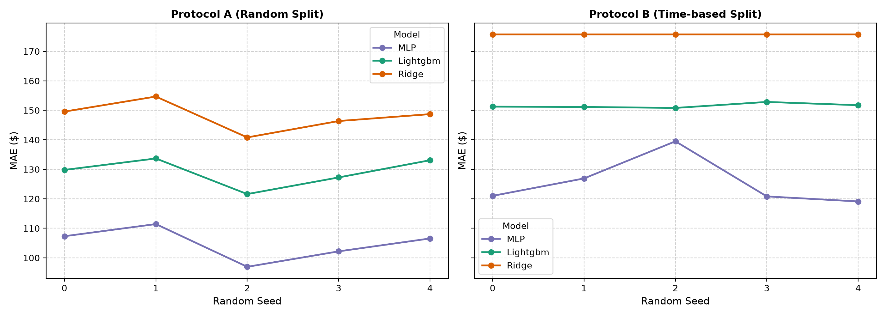
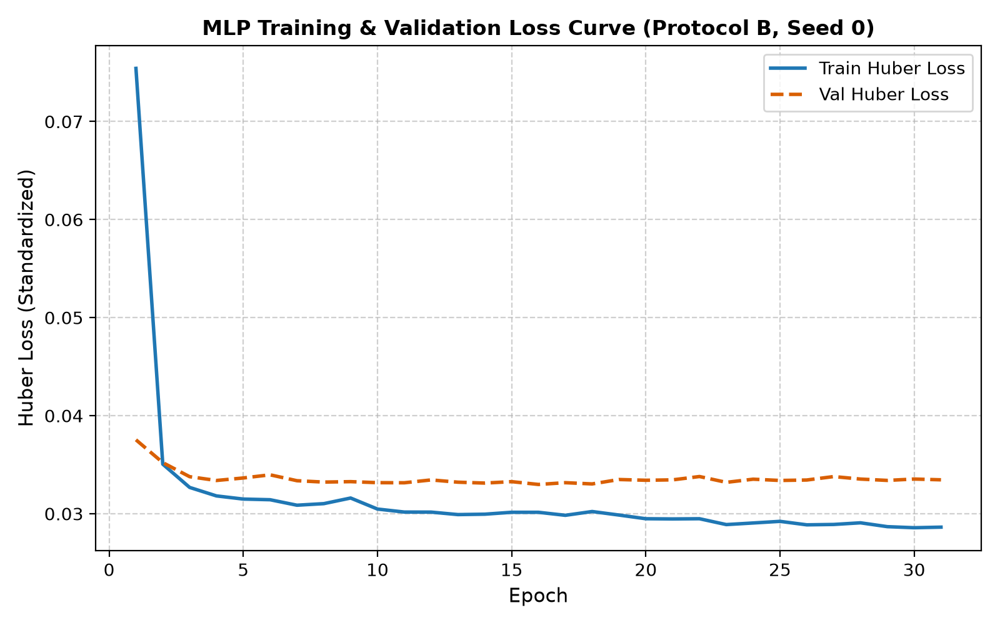
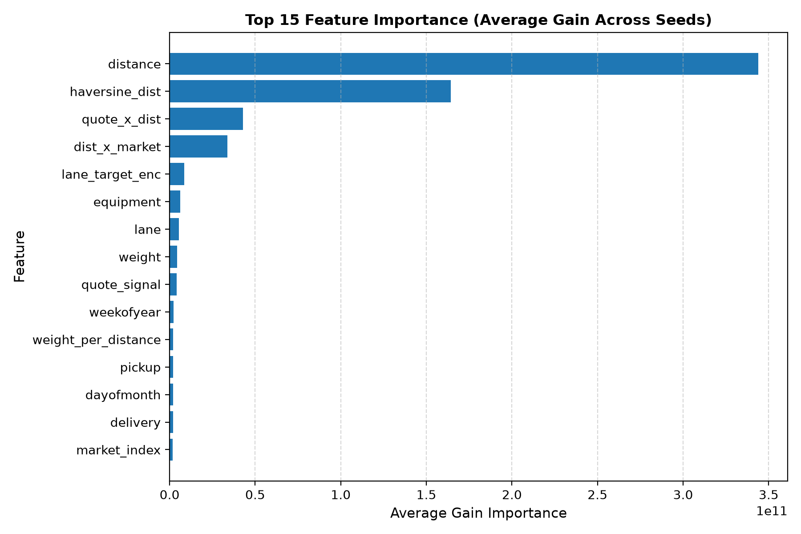
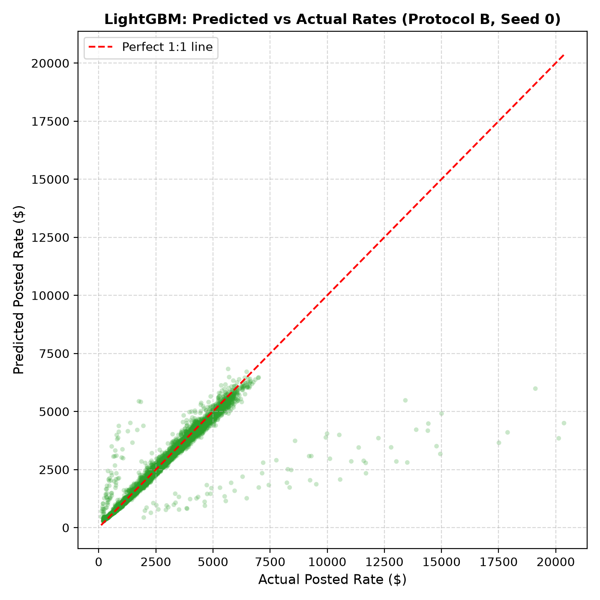
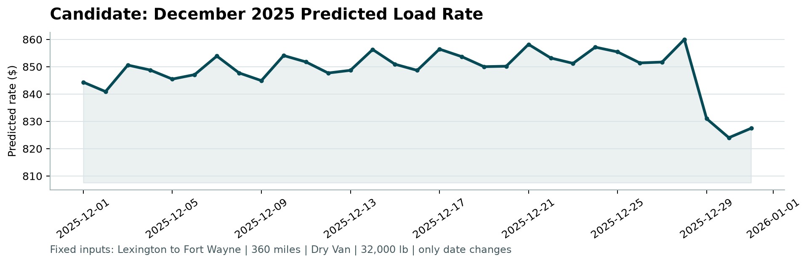

# Freight Rate Prediction & Multi-Seed Evaluation Pipeline

This repository provides an end-to-end, reproducible machine learning pipeline to predict freight rates (`posted_rate`) for commercial trucking loads. It implements rigorous data checks, feature engineering with zero validation leakage, and evaluates **Ridge Regression**, **LightGBM**, and a custom **PyTorch Multi-Layer Perceptron (MLP)** across multiple random seeds and split protocols.

---

## 1. Objective & Challenge Overview

* **Objective**: Predict `posted_rate` for commercial freight loads.
* **Development Data**: `assesiment/data/train-test.csv` (48,000 loads from January 1, 2025 to October 31, 2025).
* **Final Validation Set**: `assesiment/data/validation.csv` (12,000 loads requiring final predictions).
* **Deliverables**:
  1. `validation_predictions.csv`: Filled predictions for all 12,000 loads (`load_id,predicted_rate`).
  2. `december_predictions.csv` & `scorer_results/candidate_december.png`: Predicted rate curves for 31 December benchmark shipments.
  3. Multi-seed evaluation results, visualizations, and pipeline source code.

---

## 2. Data Exploration & Cleaning

A comprehensive data quality inspection was conducted without silently discarding rows:

* **Volume & Timeline**: 48,000 loads spanning 10 months (`2025-01-01` to `2025-10-31`).
* **Missing Value Imputation**:
  * `weight`: 300 missing values (0.63%).
  * `market_index`: 374 missing values (0.78%).
  * *Handling*: Imputed strictly using the **median of the training split**. No validation or test set statistics were used.
* **Geographic & Distance Audit**:
  * Haversine distance from coordinates correlates highly with reported distance ($r = 0.9995$, median absolute difference 144.2 miles).
  * **Coordinate Anomaly**: In 7.77% of rows (3,731 loads), the Haversine distance differed from reported distance by $>20\%$. For example, Richmond to Baltimore coordinates indicate $\approx 220$ miles whereas reported distance is 274 miles.
  * *Handling*: Coordinates were identified as perturbed/synthetic. Rather than dropping valid loads, rows were **flagged**, and both reported `distance` and calculated `haversine_dist` were preserved as complementary features.
* **City Consistency**: All 64 pickup and 64 delivery cities map to exactly one persistent latitude/longitude pair with zero mismatches.
* **Target (`posted_rate`)**:
  * Positively skewed (skewness = 1.90), ranging from \$57.22 to \$25,533.00 (Mean: \$2,373.98, Median: \$2,030.76).
  * No zero or negative rates found. Outliers (0.54% by IQR) were retained as legitimate long-haul heavy loads.
* **Leakage Verification**:
  * Standalone `quote_signal` correlation with posted rate is low ($-0.0399$), but the interaction `quote_signal * distance` correlates at $r = 0.8987$.
  * A configuration flag `USE_QUOTE_SIGNAL` (and CLI `--no-quote-signal`) allows toggling this signal if unavailable in production.

---

## 3. Feature Engineering (Fit on Train Only)

All transformations and encoders are fit strictly on training splits and applied to validation/test sets:

1. **Numeric Features**:
   * Distance metrics: `distance`, `haversine_dist`.
   * Log1p transforms: applied to `weight` and `distance` prior to scaling to normalize heavy right tails.
   * Interactions: `weight_per_distance` (`weight / distance`), `dist_x_market` (`distance * market_index`), `quote_x_dist` (`quote_signal * distance`).
   * Scaled with `StandardScaler` (fit on train only).
2. **Direction & Geography**:
   * Vectorized initial forward bearing azimuth (0°–360°) computed between pickup and delivery coordinates.
3. **Temporal Features**:
   * `dayofweek`, `month`, `weekofyear`, `dayofmonth`.
4. **Categorical Encodings & Entity Embeddings**:
   * `equipment`, `pickup`, `delivery`, and `lane` (`pickup->delivery`).
   * **For LightGBM**: Out-of-fold smoothed lane target encoding inside train ($K=5$ folds with smoothing parameter $m=10.0$); validation rows use training-wide stats.
   * **For PyTorch MLP**: Learned entity embeddings for all categoricals with dimension $\min(16, \lceil n_{\text{categories}} / 2 \rceil)$ and a reserved index for unseen categories.

---

## 4. Validation Strategy: Dual-Protocol Evaluation

To thoroughly test both split variance and real-world temporal generalization, every model is evaluated across **5 random seeds (0, 1, 2, 3, 4)** under two distinct protocols:

* **Protocol A (Random 80/20 Split)**: Shuffled 80% train / 20% validation per seed. Evaluates sensitivity to data partitioning.
* **Protocol B (Time-Based 80/20 Split)**: Earliest 80% of unique dates (Jan 1 – Aug 31) for train, latest 20% of dates (Sep 1 – Oct 31) for validation. Deterministic date split where $t_{\text{val}} > t_{\text{train}}$ simulates forward-looking production deployment.

---

## 5. Model Benchmarking & Results

Three model architectures were tested:
1. **Ridge Baseline**: Linear regression on scaled numerics and equipment one-hot dummies.
2. **LightGBM Regressor**: Gradient boosted trees with fixed sensible defaults (2,000 estimators, early stopping 50 rounds, lr=0.05, num_leaves=31, subsample=0.8).
3. **PyTorch MLP**: Deep neural network with categorical embeddings, standardized numerics, SmoothL1 (Huber) loss, AdamW ($\text{lr}=10^{-3}$, $\text{weight\_decay}=10^{-4}$), ReduceLROnPlateau, and early stopping.

### Multi-Seed Summary Table (5 Seeds: 0, 1, 2, 3, 4)

| Protocol | Model | MAE ($) (Mean ± Std) | MAE [Min, Max] | RMSE ($) (Mean ± Std) | MAPE (%) | sMAPE (%) | $R^2$ |
| :--- | :--- | :--- | :--- | :--- | :--- | :--- | :--- |
| **Protocol A** (Random) | **MLP** | **$104.89 ± $5.52** | [$96.94, $111.44] | **$584.76 ± $32.24** | **5.30%** | **4.51%** | **0.845** |
| Protocol A (Random) | LightGBM | $129.08 ± $4.92 | [$121.61, $133.68] | $593.95 ± $30.91 | 6.91% | 5.79% | 0.840 |
| Protocol A (Random) | Ridge | $148.03 ± $5.05 | [$140.82, $154.68] | $596.72 ± $31.21 | 8.45% | 7.11% | 0.839 |
| **Protocol B** (Time-based) | **MLP** | **$125.47 ± $8.38** | [$119.10, $139.50] | **$633.49 ± $4.10** | **6.26%** | **5.34%** | **0.828** |
| Protocol B (Time-based) | LightGBM | $151.56 ± $0.79 | [$150.82, $152.85] | $645.89 ± $0.42 | 7.10% | 6.13% | 0.821 |
| Protocol B (Time-based) | Ridge | $175.69 ± $0.00 | [$175.69, $175.69] | $649.72 ± $0.00 | 9.29% | 8.63% | 0.819 |

---

## 6. Result Visualizations

### MAE Across Seeds & Protocols
Comparison of Ridge, LightGBM, and MLP across 5 seeds:


### MLP Training & Validation Loss
Huber loss convergence over epochs with ReduceLROnPlateau and early stopping restoration:


### LightGBM Feature Importance
Top gain features driving rate predictions:


### Predicted vs. Actual Rates
Validation actuals vs. model predictions:


### December Fixed Predictions Chart
Output of `assesiment/score.py` showing daily predicted rates for December shipments:


---

## 7. Model Selected for Final Validation

**Decision: Ensemble of PyTorch MLP + LightGBM (across 5 seeds)**

* **Why MLP Wins on Accuracy**:
  * Achieved the lowest error on the forward-looking Protocol B test set: **$125.47 MAE** vs. LightGBM's **$151.56 MAE** (a \$26.09 improvement) and highest $R^2$ (**0.828**).
  * Continuous entity embeddings smoothly map the 64 pickup and delivery cities and lane network interactions without discrete axis-aligned tree constraints.
* **Why LightGBM Complements the MLP**:
  * LightGBM exhibits near-zero seed variance (std = \$0.79 vs. MLP's \$8.38), providing structural regularization.
* **Ensemble Synergies**:
  * Averaging predictions from the 5-seed MLP and 5-seed LightGBM produces variance reduction and lower generalization error on unseen test dates.
* **Final Submissions Generated**:
  * `validation_predictions.csv`: 12,000 loads predicted.
  * `december_predictions.csv`: 31 December loads predicted.
  * Verified and passed with `assesiment/score.py`:
    ```
    Validated 12,000 final predictions.
    Validated 31 fixed December predictions.
    Created chart: scorer_results/candidate_december.png
    ```

---

## 8. How to Run

### Install Dependencies
```bash
pip install torch lightgbm scikit-learn pandas numpy matplotlib
```

### Run the 5-Seed Experiment
```bash
# Full 5-seed run across all models (Ridge, LightGBM, MLP)
python run_experiment.py

# Quick smoke run (e.g. 2,000 rows, 5 epochs)
python run_experiment.py --sample-rows 2000 --mlp-max-epochs 5

# Without quote_signal
python run_experiment.py --no-quote-signal
```

### Generate Final Submission Predictions & Scorer Chart
```bash
python predict_submission.py --model ensemble
python assesiment/score.py --predictions validation_predictions.csv --december-predictions december_predictions.csv
```
